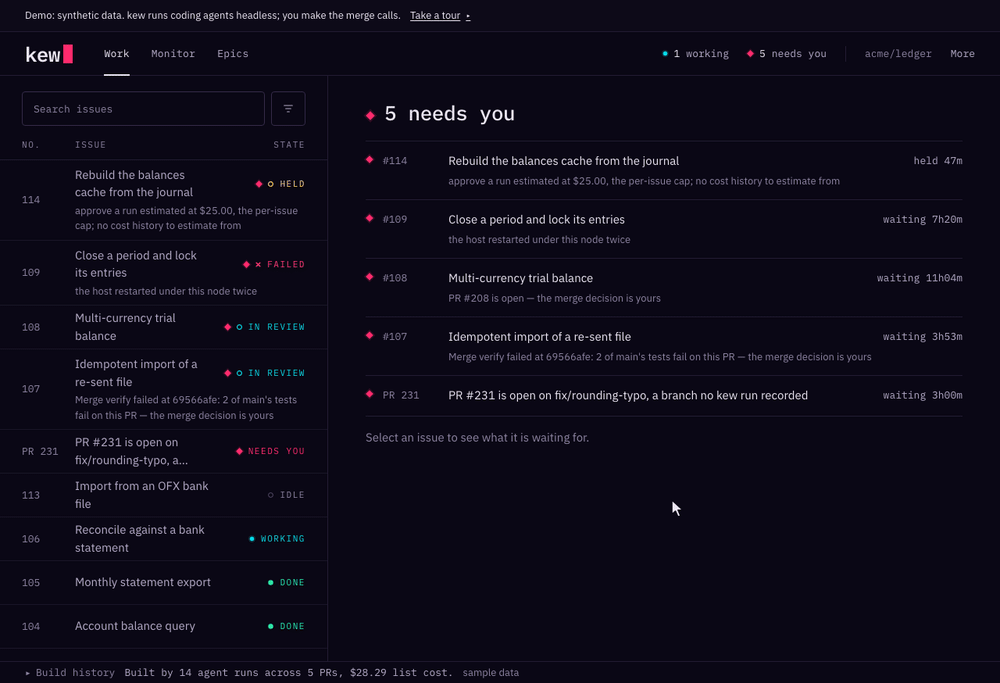

<!-- kew: the open-source control plane for autonomous coding agents -->
<div align="center">

# kew

**The open-source control plane for autonomous coding agents**

*Queue up your agents.*

[](LICENSE)
[](https://www.python.org)



<sub>The web console, recorded on the public demo. Its data is synthetic.</sub>

</div>

---

## Why

**You can offload the work without surrendering the judgment.**

The risk with autonomous agents isn't that they write bad code — it's that you stop reading it. Accept enough diffs that "look done" and your accuracy starts tracking the model's: right when it's right, wrong when it's wrong, confident either way. Most AI tooling is built to make that easy.

kew is built for the other posture. You scope the work; agents do it under budget, a security boundary, and an audit log; and what comes back is a **pull request** — one you review by hand, or hand to a fresh agent to review. The governance isn't overhead; it's what keeps you the decision-maker. → [Read the philosophy](https://kew.dev/docs/philosophy/).

So: your backlog has 30 issues, you have time for 3. Label the well-scoped ones `ready`, and they get worked in parallel overnight — context-switching, branch setup, implementation, test runs, and PR creation, handled. The scoping and the review stay yours.

**A change never defines its own proof.** kew treats the agent as an untrusted author. It does not publish from the agent's Git repository: it reads the files as data, rebuilds the commit on the host and scans it before the push. When an agent edits a test, the merge verify runs the base branch's copy of that test against the new code (wired to kew's own repository layout today). The reviewer's verdict comes from the reviewer's own output stream, never from a file the reviewed code could write. → [How kew decides a change is proven](https://kew.dev/docs/proof/).

**Built with itself.** kew's agents opened 1,156 of the 1,615 pull requests merged into kew's development repository between 2026-03-17 and 2026-11-10 (bots excluded). In October and November they opened 485 of the 538 merged (90%). kew's reviewer, a fresh agent and not a person, judged 634 of the merged pull requests from 2026-07-23 on and sent back 351 of them at least once first. Every merge went through the maintainer's GitHub account.

<p align="center">
  
</p>

<p align="center"><sub><code>kew audit verify</code> on the ledger of kew's own development, recorded on 2026-11-13.</sub></p>

## What it does

- **Picks the highest-priority `ready` issue** from your GitHub queue
- **Spins up a standalone clone** (its own `.git`, cloned `--no-hardlinks`) so work never touches your main checkout
- **Launches the configured runner** with a structured prompt, budget controls, and security controls
- **Streams progress** to your terminal in real time
- **Creates a PR** with a structured dispatch report when done
- **Transitions labels** through the lifecycle: `ready` -> `in-progress` -> `pr-pending-review`
- **Dispatches PR reviews** -- when reviewers leave comments, point the agent at the PR and it addresses them
- **Runs in parallel** -- multiple workers, each in their own clone, processing the queue concurrently
- **Retries with session resume** -- transient failures reuse runner-native sessions when supported
- **Enforces budgets** -- per-issue, daily, and weekly spend caps refuse a dispatch that would exceed them
- **Notifies a webhook** -- `[alerting].webhook_url` posts run outcomes (success/failure) and approval holds
- **Auto-fixes CI** -- `kew ci-fix` dispatches an agent to fix failed GitHub Actions runs
- **Runs governed loops** -- `kew dispatch <issue> --loop` supervises a single agent session to a verified, observable close: a ci-green stop condition, step-level pause/resume/reassign, and a budget watchdog
- **Supports multiple runners** -- Claude Code, OpenCode, official Codex, pi, Hermes, and Lemonade, with per-complexity routing
- **Terminal dashboard** -- `kew tui` provides a live Textual-based view of queue, workers, costs, and agent output

### Governance

kew's deeper job is to be the **governance layer** for autonomous agents — self-hosted, cross-runner, and aware of runs and outcomes rather than API calls:

- **Approval gates** (opt-in, `[approval] threshold_usd`) -- holds any dispatch above an estimated-cost threshold for human sign-off (`needs-approval`); approve/deny from the terminal (`kew approve`), the TUI, or the web cockpit. GitHub-comment approval (`/approve`, `/deny`) needs a workflow like kew's own `.github/workflows/approval.yml`, which runs on a self-hosted runner next to the run store; neither `kew setup` nor `create-kew` installs it
- **Fleet kill switch** -- `kew stop` signals every in-flight agent's process group and latches dispatch until `kew resume`; under `kew run`, a circuit breaker latches dispatch on a fleet budget breach and lets in-flight runs finish, and a single run far above its baseline is stopped and recorded
- **Tamper-evident audit log** -- every recorded governance event is hash-chained (`kew audit verify`); audit writes are best-effort, and the chain proves integrity for what was recorded. You choose the anchor sink. It defaults to `audit-anchors.jsonl` at the project root. The `audit-anchor` workflow can commit it to the repository. Each event carries the hash of the policy in force when that hash could be computed, and `kew health` attests the control plane to itself
- **Governed adversarial review** -- optional fresh-context reviewer between PR-open and approval on an epic (`[review].adversarial`): each round's verdict is chain-attested and bound to the exact commit reviewed, and in blocking mode the merge pass merges only the pull request head that was reviewed — the verdict is evidence for your approval, kew merges an epic's pull request after your GitHub approval, and without one only under a standing rule you sign for `kew drive`
- **Outcome-linked spend** -- `kew report` ties cost to *merged PRs* and review cycles, with a per-model scorecard (`kew report --models`) — measured from your own fleet, not a benchmark; governed-review runs are a separate attested budget pool
- **Web console** -- `kew serve` shows what needs you, what is running and where each epic stands: approve/deny holds or stop the fleet from a browser, over a token→session-cookie surface (CSRF + Origin checks, loopback by default, explicit `--expose` opt-in)

## Runners

kew is **runner-agnostic**. It owns the parts that make autonomous dispatch safe — the queue, standalone clone isolation, budgets, the security hook, the audit log, and governance — and treats the coding agent itself as a pluggable, supervised subprocess. Pre-dispatch budget caps, the audit log and the `kew stop` latch apply to every runner. The caps count only the spend a runner reports, approval gates apply when `[approval] threshold_usd` is set, and the in-run cost watchdog needs a cost signal from the runner (the security hook is a Claude Code hook; on ordinary dispatch other runners are bounded by the container or, for official Codex, its own sandbox, and on the host-execution paths listed in [Security](https://kew.dev/docs/security/#sandboxed-dispatch-credential-posture) they have no kew guard), so you can route different issues to different agents without giving up the control plane.

| Runner | Use it for | Models |
|--------|-----------|--------|
| **`claude-code`** *(default)* | The deepest integration — session resume, structured stream-json events, cost from the runner itself | Claude (Opus / Sonnet / Haiku) |
| **`opencode`** | One integration that reaches many providers, including local models | Gemini, GPT / o-series, Codex, Ollama, OpenRouter, and 70+ others |
| **`codex`** | Official OpenAI Codex CLI with native host sandboxing and kew-brokered publication | Explicitly selected authenticated Codex models |
| **`pi`** | The [pi](https://pi.dev) coding agent (`@earendil-works/pi-coding-agent`) | pi |
| **`hermes`** | Headless OpenRouter-only runner with usage-file metering | OpenRouter |
| **`lemonade`** *(experimental)* | kew's own agent loop for local models (AMD Lemonade, llama-server, LM Studio, vLLM, Ollama) | Any model at a local OpenAI-compatible endpoint (`lemonade/<name>`) |

### Experimental

[Switchyard](docs/cli/switchyard.md) is an experimental inference transport beside `[routing]`.

The Linear source is also **experimental**. Its epic driver and delegation rail have run end to end against a live Linear workspace. [What works with Linear](docs/configuration.md#what-works-with-linear) lists the supported surfaces and the ones that are GitHub-only at launch.

**Routing.** Set a `default` runner, then optionally route by issue **complexity** (`simple` / `medium` / `complex`) in `kew.toml` — each tier can pick its own runner and model:

```toml
[routing]
default = "claude-code"                                                            # default runner
simple  = { runner = "opencode",    model = "openrouter/google/gemini-3.8-flash" } # cheap model for easy issues
complex = { runner = "claude-code", model = "claude-opus-5-5" }                    # strongest for hard issues
```

kew also **infers the runner from the model name** when you only set a model — `claude-*` → `claude-code`; `gemini-*`, `gpt-*`, `o1/o3/o4-*`, `openrouter/*` and `ollama/*` → `opencode`; `lemonade/*` → `lemonade`. Official Codex and Hermes require explicit routes; GPT/o-series inference remains OpenCode. See the [runner docs](https://kew.dev/docs/runners/) and [Configuration](https://kew.dev/docs/configuration/) for all six `[agent.<runner>]` sections.

> **Why this matters:** governance that lives inside one vendor's console governs one vendor. kew keeps the budget caps, the audit log and the kill switch *outside* the runner, so they hold for every runner kew dispatches, cloud or local. The caps can only count the spend a runner reports, and stopping a run mid-way on cost needs a runner that reports cost as it goes.

## Quick Start

Run every step from inside the git repository you want kew to work on, with
[`uv`](https://docs.astral.sh/uv/) installed and `gh` logged in (`gh auth login`).
The [Getting Started](https://kew.dev/docs/getting-started/) guide has the full
path; [Agents](https://kew.dev/docs/agents/) has the same path for a script or
an agent (`kew init --yes`, `kew doctor --json`).

<!-- INTERIM-INSTALL:START — replace the install line with `uv tool install kew-cli` once packages publish (PUBLISH_RELEASE flipped) -->
```bash
# 1. Install the CLI (from git until kew-cli publishes to PyPI)
uv tool install "kew-cli[serve] @ git+https://github.com/thossullivan/kew.git@main#subdirectory=kew"
```
<!-- INTERIM-INSTALL:END -->

```bash
# 2. Write kew.toml from what kew detects; init also runs `kew setup`
kew init

# 3. Check that dispatch is ready; run each `fix:` it prints, then re-run
kew doctor

# 4. Preview, then dispatch, the highest-priority issue labeled `ready`
kew run --dry-run
kew run
```

A git install does not include the web UI bundle, so `kew serve` shows a "web UI
is not built" page. Install kew as a tool; do not add it to your application's
dependency manifest. Docker, OrbStack, Podman and OpenShell are agent runtimes —
where kew runs the coding agent — not ways to install kew.

### Before the first dispatch

Dispatch is contained by default: `[sandbox] enabled = "auto"` runs the agent in a container, and kew **refuses** to dispatch when no container runtime is found. So a first dispatch on the default `claude-code` route needs three more things, and `kew doctor` names the `fix:` command for each one that is missing:

1. **A container runtime.** Docker Desktop, OrbStack or Podman, running — or OpenShell (`kew init --runtime openshell`).
2. **The agent image.** kew launches the digest-pinned image named in your `kew.toml`. kew never pulls it. `kew sandbox build` builds it from the inputs shipped with the package.
3. **The allowlist network.** `kew sandbox network` creates `kew-allowlist` as a plain bridge on your runtime.
   kew installs no firewall rules on it: a plain bridge has **unrestricted egress** while the container holds your provider key.
   See [Security](https://kew.dev/docs/security/#sandboxed-dispatch-credential-posture) for details.
   Set `network = "open"` only for explicit unrestricted egress.
   Ordinary contained dispatches warn about open egress.
   Review, resolve, ci-fix, and epic plan do not warn.

On a terminal, `kew init` offers to run both commands for you.

The `codex` runner declares a **native** posture: the Codex CLI sandboxes itself and kew launches no container, so a `codex` route needs none of the three.

To run an agent on the host with no container boundary, set `[sandbox] enabled = false` **and** `dangerously_skip_containment = true`; the agent then inherits your environment. See [Security](https://kew.dev/docs/security/#sandboxed-dispatch-credential-posture).

First-class loops (`kew dispatch <issue> --loop`) are **not** contained: kew has no contained loop launch, so a loop's agent runs on the host. A loop on the default `claude-code` route refuses before any checkout or agent work, with exit 2, unless `[sandbox] dangerously_skip_containment = true` is set. A runner that contains itself, such as `codex`, needs no flag.

**Flight Recorder:** under `kew serve`, each run's page (`/runs/<id>`) shows its
recorded evidence: identity, route, lineage, the sealed change set, cost, and gaps.
The per-run `timeline` and `events` API routes are live, but no web page reads them yet;
see [docs/web](docs/web/index.md).

## Command overview

The full toolkit, grouped by what it's for. See the [CLI reference](https://kew.dev/docs/cli/) for every option and example.

**Dispatch & fix**

| Command | What it does |
|---------|--------------|
| `kew run` | Take the highest-priority `ready` issue from the queue and dispatch it (`--drain` to keep going until the queue is empty, `--workers N` for parallel) |
| `kew dispatch <issue>` | Dispatch one named issue; `--loop` supervises it as a first-class loop, `--approve` releases an approval hold |
| `kew finalize <run-id>` | Repair a run left awaiting host publication after out-of-band publication |
| `kew loop pause` / `loop resume` | Gracefully pause a running loop, or resume a `needs_human` / `budget_limited` one with guidance |
| `kew review <pr>` | Gather PR review comments and dispatch an agent to address them |
| `kew resolve <pr>` | Dispatch an agent to resolve merge conflicts on a PR branch |
| `kew ci-fix <run>` | Dispatch an agent to fix a failed GitHub Actions run |
| `kew epic <cmd>` | Build and drive an `epic:<name>` dependency graph — dispatch nodes in order, merge approved PRs (optional [governed adversarial review](https://kew.dev/docs/how-it-works/#governed-adversarial-review) between PR-open and approval) |
| `kew delegate watch` | Watch for assign-to-kew Linear issues and claim → dispatch them (foreground; requires `tracker.type = "linear"`) |

**Observe**

| Command | What it does |
|---------|--------------|
| `kew status` | Queue counts, costs (`--cost`), and aggregate analytics (`--analytics`) |
| `kew tui` | Live terminal dashboard — queue, workers, reviews, analytics, approvals |
| `kew serve` | Local web console: Work, Monitor and Epics, with approve, deny and stop behind a session |
| `kew attach` | Stream a running agent's live event log to your terminal |
| `kew report` | Outcome-linked spend report; `--models` for the per-model scorecard |
| `kew export` | Export run history to JSON/CSV or a model-eol model inventory |

**Govern**

| Command | What it does |
|---------|--------------|
| `kew approve` / `kew deny` | Release or park a `needs-approval` hold (audited) |
| `kew stop` / `kew resume` | Kill all in-flight runs and latch dispatch, then re-enable it |
| `kew audit` | Inspect / `verify` / `anchor` the tamper-evident log; `audit policy <hash>` |
| `kew health` | Attest the control plane to itself — meter, budgets, audit, runner |
| `kew canary` | Attest kew still reads fresh vendor-CLI output correctly |

**Operate**

| Command | What it does |
|---------|--------------|
| `kew setup` | Create labels, the security hook, and directories |
| `kew cleanup` | Find and fix orphaned label states after a crash |
| `kew report sync` | Backfill PR outcomes (merged/closed, reviews, diff stats) for past runs |
| `kew backup` / `kew restore` | Snapshot and restore `dispatch.db` (+ config) as a portable archive |
| `kew ingest` | Ingest external runner usage (e.g. Claude Code OTel) into the record |
| `kew skills` | Install, update, and diff kew's shipped agent skills and the security-guard hook |

## Requirements

| Tool | Purpose | Install |
|------|---------|---------|
| [uv](https://docs.astral.sh/uv/) | Install the kew CLI | `brew install uv` |
| Node.js 18+ with npm | Install the `claude` CLI | `brew install node` |
| [gh](https://cli.github.com), logged in | GitHub API | `brew install gh`, then `gh auth login` |
| [git](https://git-scm.com) | Version control | `brew install git` |
| Docker Desktop, [OrbStack](https://orbstack.dev), Podman or [OpenShell](https://kew.dev/docs/openshell/) | Agent runtime for contained dispatch (the default) | `brew install --cask docker` |
| [claude](https://docs.anthropic.com/en/docs/claude-code) | AI coding agent | `npm i -g @anthropic-ai/claude-code` |
| Python 3.13 | Runtime | `brew install python@3.13` |
| `ANTHROPIC_API_KEY` | Anthropic API authentication | [docs](https://kew.dev/docs/authentication/) |

See [Authentication](https://kew.dev/docs/authentication/) for API key requirements and why Pro/Max subscription OAuth should not be used for autonomous dispatch.

See [Troubleshooting](https://kew.dev/docs/troubleshooting/) for common failure modes and solutions.

## Documentation

Full documentation is available at **[kew.dev/docs](https://kew.dev/docs)**.

| Guide | Description |
|-------|-------------|
| [Getting Started](https://kew.dev/docs/getting-started/) | Install and dispatch your first issue |
| [CLI Reference](https://kew.dev/docs/cli/) | Every command, option, and example |
| [Configuration](https://kew.dev/docs/configuration/) | Full `kew.toml` reference |
| [Security](https://kew.dev/docs/security/) | What the security hook blocks and why |
| [How It Works](https://kew.dev/docs/how-it-works/) | Dispatch loop, labels, prompt system |
| [Troubleshooting](https://kew.dev/docs/troubleshooting/) | Common failure modes and solutions |

## Development

```bash
cd kew
uv sync
export PYTEST_XDIST_AUTO_NUM_WORKERS=6  # Same worker cap as CI; verify.sh sets it for you
uv run pytest -n auto -m "not serial"   # Run tests, parallel
uv run pytest -m serial                 # Timing-sensitive tests, one process
uv run ruff format .          # Format
uv run ruff check .           # Lint
uv run mypy src/              # Type check
```

## Roadmap

kew's roadmap is organized as a governance ladder — the same control machinery (budgets, audit, policy, kill switch) extended to new actors, origins, and standards of proof. The full, continuously-updated version lives at **[kew.dev/docs/roadmap](https://kew.dev/docs/roadmap/)**.

**Shipped:**
- **Agent orchestration** — priority queue, standalone clone isolation, parallel workers, retry-with-resume, review/resolve/ci-fix dispatch, multi-runner routing (Claude Code, OpenCode, official Codex, pi, Hermes, and experimental Lemonade), and **first-class loops** (`kew dispatch --loop`: a governed session driven to a verified close).
- **M1–M2 governance** — three-tier budgets with an automatic circuit breaker, the fleet kill switch, approval gates, outcome-linked spend (`kew report`), cache-aware pricing, `kew health`, and remote approve/deny.
- **M3: tamper-evidence** -- a hash-chained audit log (`kew audit verify`) anchored to a sink you choose. The default is `audit-anchors.jsonl` at the project root. The `audit-anchor` workflow can commit it to the repository. Each event carries the hash of the policy in force when that hash could be computed, with durable backup/restore and cross-runner usage ingestion.
- **M4 — the governor's surface** — the per-model scorecard (`kew report --models`), the in-TUI approve dialog, and approve, deny and stop in the web console (`kew serve`).
- **Since M4** -- the epic driver (`kew epic`) and the supervised `kew drive`; governed adversarial review (opt-in); host-owned publication, so a contained agent holds no credential that can push; a merge verify that runs the base branch's copy of each edited test against the pull request's code (wired to kew's own repository layout today); and the web console's Work, Monitor and Epics pages.

See the [roadmap](https://kew.dev/docs/roadmap/) for what comes next.

## License

[Apache License 2.0](LICENSE)
