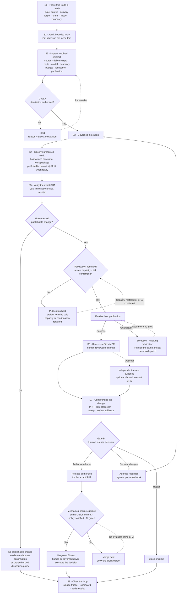
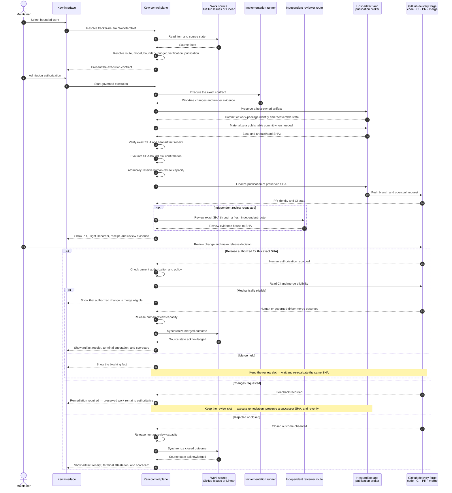
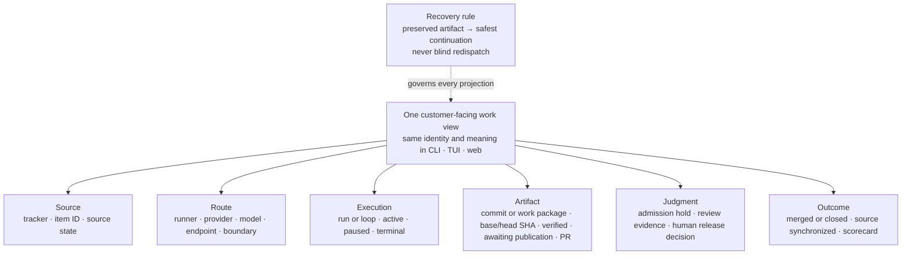
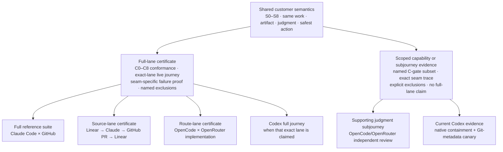

# Kew production-certified customer journeys

Dated: 2026-08-17

Status: **ACCEPTED PRODUCT JOURNEY AND CERTIFICATION POLICY — governs product-coherence planning**

Authority: derives from the accepted
[Kew product charter](2026-08-17-kew-product-charter.md). This document defines
the customer outcomes and certification model for the next product-coherence
release. Its open policy choices were ratified by the maintainer on 2026-08-17.
It is not an implementation plan, backlog mutation, or claim that a journey is
already production-certified.

## The product decision this enables

Kew should certify complete customer outcomes rather than isolated features or
a Cartesian matrix of every runner, tracker, command, and surface.

The recommended structure is:

1. one full **reference certificate** on Claude Code + GitHub;
2. one shared customer-journey and recovery contract;
3. **exact-lane certificates with shared conformance evidence** for Linear,
   OpenCode/OpenRouter, Codex, and any other implementation lane Kew claims,
   while reviewer/canary proofs remain explicitly scoped; and
4. the same state and safest-next-action semantics in CLI, TUI, and web.

Historical dogfood establishes product validity. A production certificate is a
fresh, bounded proof of the exact current Kew version, runner/model contract,
containment boundary, and customer journey through a live validity trace.
Static inspection may establish **configured; live unverified**, but never
**ready**. Security hardening can make recertification due without making a
lane unsupported.

## Visual 1 — the north-star customer journey

This is the product journey. Runners and trackers are route/source profiles
through it, not separate products. The pull request is a publication of the
preserved artifact; it is not the durable artifact itself. Independent review
is evidence; it never supplies the release decision.

A no-change result is a real terminal branch, but not a successful substitute
for a reviewable change. The host must first attest the exact base/head state,
clean diff, absence of preserved edits, and truthful terminal classification in
the receipt. It may close the source item only when the admitted contract
already authorizes that evidence-backed disposition; otherwise it waits for
human confirmation. It never manufactures a pull request or reports a merged
outcome.

The host-owned artifact and publication steps describe the certification
target. The Kew repository's current dogfood configuration keeps container
publication in observational shadow mode; shadow evidence can justify
promotion, but a journey certificate requires the certified pull request
itself to be published through the promoted fresh host-owned boundary.

## Service blueprint and moments of truth

| Stage | Customer job and expected outcome | Kew responsibility | Durable proof | Moment of truth |
|---|---|---|---|---|
| 0. Ready | Know whether this exact route can safely accept work before trusting it with time, code, or money | Inspect the configured source/forge, runner/model, auth, boundary, metering, verification, and publication capabilities; when readiness is claimed, run an authorized bounded validity canary with disclosed cost | Versioned route contract, capability status, preflight facts, and live-canary evidence or an explicit `live unverified` state | “Ready” means the declared route is operationally admissible and its execution leg is live-verified; it is not a journey certificate |
| 1. Admit | Choose one bounded item and know it will run once | Normalize a tracker-neutral work identity; check scope and admission | Source tracker, item ID, admission actor and time | No accidental or duplicate work |
| 2. Contract | Understand the route, cost, risk, and expected finish before spending | Resolve source, GitHub delivery repo, runner/provider/model/endpoint, capabilities, boundary, budget, verification, and publication | Resolved contract, config/policy hash, capability evidence | No hidden downgrade or silent reroute |
| 3. Execute | Observe progress and intervene without understanding runner internals | Enforce containment and budget, stream meaningful progress, expose stop/hold | Run identity, telemetry, usage/cost provenance, holds | Status is truthful; stop means stop |
| 4. Preserve | Trust that useful work survives a runner, network, or publication failure | Give the preserved artifact a stable host-owned identity; this may be a commit directly or a recoverable work package that is later snapshotted to a publishable commit | Artifact identity and recovery pointer; work-package identity when used; then base/head SHAs, diff, and branch association | Failure never destroys or needlessly repeats work |
| 5. Verify | Understand what changed and whether it passed the declared bar | Verify the exact SHA; seal an immutable artifact receipt over the evidence-journal prefix; optionally run independent review | Checks, diff progression, artifact receipt with `through_seq`, SHA-bound review evidence | Evidence is comprehensible and bound to the artifact without pretending later lifecycle facts already exist |
| 6. Publish | Receive exactly one reviewable GitHub change | Publish from the host boundary without exposing publication authority to the agent | Branch/PR association, publication event, CI facts | Outage becomes awaiting publication, not failed execution |
| 7. Decide | Approve, request changes, or reject while retaining judgment | Keep admission and release authorization distinct; enforce current non-author approval and policy | Human decision, reviewer identity, approved SHA | Kew executes judgment; it does not manufacture it |
| 8. Learn | See the correct terminal state where the work originated and learn from the outcome | Reconcile GitHub outcome to GitHub/Linear source, scorecard, cost, and audit; append a terminal attestation chained to the artifact receipt | Merged/closed result, tracker sync, outcome metrics, terminal journal prefix/attestation | No split-brain tracker or misleading success |

## Visual 2 — the service blueprint

The interfaces are customer touchpoints over one control plane. They do not
own separate work state. The runner produces candidate changes and evidence;
the host boundary owns the durable artifact and publication authority; GitHub
owns code review and delivery; GitHub Issues or Linear owns the source work
state.

## Visual 3 — one work truth, not one overloaded status

`awaiting_publication` belongs to artifact/publication state. It does not mean
the execution failed. A remote service outage is availability state, not an
empty healthy queue. A Linear identifier remains a Linear identifier after
admission; it never becomes GitHub-shaped `#0`.

## The customer journey family

The five journeys below cover the product promise without replaying every
command for every route.

| ID | Customer journey | Customer outcome | Certification scope |
|---|---|---|---|
| PCJ-0 | Prove this route is ready | Before entrusting work or money, the maintainer sees that the exact source, delivery forge, route, boundary, budget, verification, and publication mode are usable and honestly constrained | C0 preflight and resolved-contract truth |
| PCJ-1 | Turn one bounded item into a decision-ready change | Admitted work becomes one verified, comprehensible GitHub change, receives a human decision, and synchronizes its outcome | Mainline S1–S8 plus bounded evidence for request-changes and reject branches |
| PCJ-2 | Drive a finite supervised epic | A human-authorized dependency graph advances without exceeding review capacity or unblocking downstream work early | Two-node epic, bounded concurrency, per-node release decision, dependent eligibility |
| PCJ-3 | Recover without losing or repeating work | A hold, crash, budget stop, publication outage, CI/conflict, or tracker outage exposes what survived and the safest continuation | Exception rail beneath every journey; same-artifact recovery and safe resynchronization |
| PCJ-4 | Understand and improve outcomes | The maintainer can comprehend the exact artifact, explain what happened, and compare route outcomes without losing requested/reported identity or cost provenance | Flight Recorder, receipt, CLI/TUI/web truth, audit, tracker outcome, scorecard |

PCJ-1 is the north-star delivery flow. PCJ-0 establishes trust before it.
PCJ-3 is a required branch beneath every journey, not optional reliability
polish. PCJ-2 proves that the same contract composes under dependency and
review-pressure. PCJ-4 makes the result understandable and useful after the
agent stops.

### PCJ-3 recovery rail

| Failure seam | Customer-safe state | Safest next action | Forbidden false outcome |
|---|---|---|---|
| Pre-run policy, budget, auth, or capability refusal | Held/refused with no launch or spend | Change the declared contract or cancel | Partial claim presented as active work |
| Stop, crash, or budget limit during execution | Every recoverable change is preserved; if no recoverable artifact exists, that evidenced fact accompanies the actionable failure | Resume preserved work or make a new human decision | Lost useful work, silent orphan, or blind fresh dispatch |
| Publication unavailable after verification | Execution complete; artifact verified; awaiting publication | Finalize the same SHA exactly once | Mark failed and ask the agent to repeat work |
| CI pending or infrastructure failure | Exact SHA and current evidence retained; delivery unavailable or waiting | Wait or retry the check against the same SHA | Re-run the agent or invalidate valid approval without a changed artifact |
| Code/test finding, conflict, or review remediation | Prior artifact retained; remediation pending | Produce a successor SHA, then reverify and renew judgment | Carry approval or review evidence across a changed SHA |
| Source tracker unavailable | GitHub delivery outcome retained; synchronization pending | Retry idempotent write-back | Empty/healthy display or falsely synchronized outcome |

## Visual 4 — certification architecture

Shared semantics define the product vocabulary, but no route inherits
production truth from another. A full-lane certificate always includes a thin
live end-to-end trace on its exact tuple and the failure proof unique to its
seam. Claude/GitHub runs the fullest suite. A reviewer proof or narrow Codex
metadata canary is deliberately scoped evidence until the exact implementation
lane completes the customer journey it claims. This is materially smaller and
more informative than the stale full runner matrix without turning shared
tests into borrowed evidence.

## Production certification gates

A certificate names an exact Kew SHA, route, security/capability profile, and
allowed configuration, policy, and verification envelope. Each trace and
change receipt still records its exact configuration/policy/verification
hashes, runner executable and model, provider endpoint, containment posture,
authentication method, and immutable image ID where a container is used.

| Gate | Required proof |
|---|---|
| C0 — Preflight | The candidate Kew build passes its own repository gates; the target project and audit chain are healthy; declared install mode, runner version/auth, route, pricing, and config resolve. The visible contract names the source, delivery repo, route/model/endpoint, boundary, budget, verification, and publication mode. A route `ready` claim additionally requires current bounded read-only source/forge auth and reachability plus an authorized live execution canary with disclosed spend; only the provider result is reusable for 24 hours. Otherwise Kew says `configured; live unverified` or the exact unavailable state. |
| C1 — Admission | A bounded work item is admitted once. Budget, policy, and worker-capacity checks record an allow or hold decision. No duplicate reservation or execution occurs. |
| C2 — Execute and preserve | The resolved runner and boundary actually launch; progress and cost/usage are observable; the lane enforces a declared resource envelope appropriate to its measured capabilities—USD where trustworthy pricing exists, otherwise explicit token, time, step, or work bounds. Accounting source/certainty is visible, unpriced never means `$0`, and a lane cannot claim dollar-budget enforcement without a nonzero planning rate. Stop terminates the child tree without an orphan and preserves every recoverable change. The host gives the artifact a stable identity—directly as a commit or, for pre-commit work, as a recoverable package—then records base and artifact/head SHAs before verification. |
| C3 — Verify and comprehend | Configured verification runs against the exact artifact SHA. An immutable artifact receipt binds route, policy, cost provenance, diff scope, checks, and the evidence-journal prefix through an explicit sequence; the agent cannot self-attest the host result. Later events append and chain rather than mutating that receipt. A no-change disposition additionally requires host evidence of the exact base/head state, clean diff, and absence of preserved edits. The web run/artifact detail consumes the timeline, diff, and events available for that route, names missing telemetry honestly, and is reachable from the operating surfaces. |
| C4 — Publish | Kew binds required diff/risk confirmation to the exact SHA, then atomically reserves human-review capacity at publication time; exact threshold cases and a two-finisher acceptance prove neither boundary can be bypassed. Failed pre-PR publication releases the reservation. A successfully published PR keeps its slot until merge, close, cancel, or another explicitly terminal non-review state, and restart reconciliation restores the same accounting. Saturation or missing confirmation holds the preserved artifact. When admitted, the promoted host-owned broker publishes exactly one GitHub PR bound to that artifact; every successor-SHA branch update also goes through the host job and reuses that slot. Publication credentials remain host-scoped. Shadow comparison is promotion evidence, not final publication certification. |
| C5 — Judge | Optional independent review is bound to the current SHA and remains evidence only. A current non-author human supplies release authorization; a separate mechanical gate requires that authorization to remain current, policy to be satisfied, and CI to be green before merge. A successor SHA invalidates earlier approval/review evidence and carries explicit lineage before re-verification. |
| C6 — Reconcile and attest | PR outcome—or an explicitly authorized no-change disposition—source tracker, cost/outcome record, scorecard, and audit converge on the same terminal truth. Publication, judgment, and synchronization attestations chain to the immutable artifact receipt; a terminal attestation seals the later journal prefix without rewriting earlier evidence. The audit chain verifies again after outcome writes and, when an external anchor is claimed, its ledger identity and head match. |
| C7 — Cross-surface truth | For the same work, CLI, TUI, and web agree on identity, route, artifact, pending decision, cost, availability, and safest action at these states: in flight, awaiting publication, published/awaiting human decision, tracker-sync failure, terminal, and remote unavailable/stale. Missing actions may link to the canonical surface, but no surface may invent different semantics. |
| C8 — Recovery | Prove the minimum recovery set: a pre-run hold launches nothing and spends nothing; stop/crash preserves every recoverable change and reports an actionable failure only when no artifact exists; publication failure after preservation becomes awaiting publication and finalizes the same SHA exactly once; CI pending/infra failure retains the same SHA, while code/conflict remediation creates a successor SHA and re-verifies it; failed tracker write-back remains sync-pending and safely converges later. |

The Claude/GitHub reference certificate is an evidence suite: one live
authorize-to-merge mainline, one live stop/kill proving child termination and
honest preservation, one live publication-failure-to-same-artifact recovery
trace, and separate bounded or automated branch cases for hold, budget stop,
request changes, reject, and CI/conflict remediation. The Linear certificate
adds the live write-back-failure and safe-resynchronization proof. No single
run can prove contradictory outcomes. A certificate must label each case as a
live exercise or bounded contract test rather than silently treating the two
forms of evidence as equivalent. Every exact implementation lane still needs
a thin live end-to-end trace on its exact route plus its seam-specific failure
proof; it does not inherit production truth from Claude/GitHub. Certificates
become due for review after material
changes to Kew's security, artifact, extraction, verification, or publication
boundary; configuration, policy, or verification behavior outside the
certified envelope; tracker/delivery API or adapter; runner CLI; model,
provider endpoint, or routing contract; authentication method; or runtime/image
bytes. Ordinary operator changes within the certified envelope remain fully
recorded in the receipt but do not invalidate support. Certificates do not
expire merely because a calendar interval elapsed.

## Current evidence posture

All named lanes are product-proven. None yet has the complete current customer-
journey certificate defined above. Their honest state as of 2026-08-17 against
the canonical local ledger and linked evidence below is **dogfooded;
recertification due**, not unsupported.

The quantitative counts are historical context, not certificate evidence. They
were read from the operator's canonical ledger on 2026-08-17: ledger identity
`1453f4bd-e62a-457f-8759-ad236b05cc0e`, with the chain verified through event
2599 at head
`49a3db44854ca37b9a55769a2a08f573d602c8870e663363ed0e51309631728d`.
Before a support claim relies on those counts, preserve the sanitized query,
result, ledger identity/head, and source snapshot digest in a committed evidence
page.

PR #1500 is now merged and
makes publication-shadow outcomes durable. Its merged serializer still has a
known evidence-integrity gap: path-bearing exception/detail text can retain an
absolute host path, while the current regression only proves that the separate
evidence-workspace field is reduced to a basename. Add actual path-bearing
detail/rejection/flag tests and redaction before a certificate relies on those
rows. This is a bounded shared prerequisite, not a reason to reopen the durable
outcome design.

| Lane | Existing evidence | Smallest current proof still needed |
|---|---|---|
| Claude Code × GitHub | Deepest historical lane: 356 successful implementation dispatches and 279 PR-producing runs through 2026-08-06 in the canonical ledger | Collect enough durable real-dispatch shadow comparisons for the explicit broker-promotion decision; after promotion, certify one current contained bounded change through C0–C8 whose PR is actually published by the fresh host-owned broker |
| Claude Code × Linear → GitHub | The canonical ledger records 24 `SFD-*` Claude successes, all 24 PR-producing, from 2026-07-19/20. The held Linear epic live acceptance report from 2026-08-04 separately proved the tracker/driver dependency and merge-to-Done delta with Codex; its operator countersign remains pending in that sheet | One current two-node Claude journey plus an injected tracker write-back failure and safe resynchronization; do not rerun the broad role matrix |
| OpenCode × OpenRouter implementation | Eight implementation successes, all eight PR-producing, through 2026-08-04 in the canonical ledger. The held O1 parity report from 2026-07-25 proved route, pricing, budget, PR, cost attribution, and audit, while recording the conservative-vs-native cost gap | Prove rebuilt-image auth and exact image, one contained implementation, explicit runner-native or conservative accounting status/certainty, enough real shadow evidence for promotion, then a PR actually published by the promoted broker and human merged |
| OpenCode/OpenRouter independent review | 53 successful adversarial-review runs through 2026-08-06 in the canonical ledger | One current fresh-context advisory review bound to exact PR head, with containment, endpoint/model, audit, no publication authority, and a human quality sample; this certifies a supporting judgment subjourney, not an implementation lane |
| Codex × GitHub | 80 successful Codex dispatches and 64 PR-producing runs in the canonical ledger; the held Codex writable canary report from 2026-07-29 plus a Codex 0.147 / `gpt-5.6-sol` run on 2026-08-17 that opened now-merged PR #1500 | After the shared path-redaction prerequisite, run one tiny Git-metadata/publication canary proving agent metadata is immutable and host publication happens once. This does not certify Codex loop, conflict-resolution, or standalone-review capabilities |

Before awarding C4 to a container lane, its promotion profile must state the
sample threshold, required case classes, allowed divergences, adjudicator, and
human GO/NO-GO record. For Kew's current broker program, the ratified minimum
separates four unlike forms of proof:

1. three durable, non-zero-change normal real-dispatch matches;
2. the two intentional live human-review flag cases,
   `www/package.json` and `.github/workflows/audit-anchor.yml`;
3. a typed, non-overridable refusal for every unsupported symlink change; the
   human may amend the work or record the capability as unsupported, but cannot
   override the refusal or accept omitted bytes as a divergence; and
4. negative Git-hook, Git-config, and remote-mutation security tests, which are
   not tracked-tree shadow samples.

There may be no unexpected or unadjudicated failed, refused, review-required,
or divergent outcome. Expected review-required outcomes must appear and be
human-judged. Silence or missing evidence never counts as a match.

## Proposed product-coherence release

The journey exposes one coherent next release rather than a collection of UI
and reliability fixes.

> **Release objective:** From admission through synchronized outcome, every Kew
> surface describes the same work, artifact, judgment, and safest next action;
> useful work is never lost or mistaken for failure, and the maintainer can
> understand the exact change before deciding.

### Outcome pillars

| Outcome | Product behavior | Journey gates it unlocks |
|---|---|---|
| One work truth | Tracker-neutral work identity and orthogonal source/route/execution/artifact/judgment/outcome state project consistently into CLI, TUI, web, APIs, and receipts | C1, C6, C7 |
| Continuity before retry | Preserved artifacts, awaiting-publication, orphan PRs, CI/conflict work, and tracker-sync failures enter one exception model with the safest continuation | C2, C4, C6, C8 |
| Comprehension before release | Restore Flight Recorder in run/artifact detail, bind the change receipt and independent evidence to exact SHA, and keep review/remediation/release terms distinct | C3, C5 |
| Human WIP is governed | Review-capacity limits and diff/risk thresholds hold publication without discarding verified work; pressure is visible everywhere | C4, C5, C7 |
| Capability claims are inspectable | The resolved contract and per-route capability/certification record show what is enforced, measured, unsupported, or due for recertification | C0, C2, C7 |

### Ratified release boundary

The coherence release should make PCJ-0, PCJ-1, PCJ-3, and PCJ-4 certifiable on
the Claude/GitHub reference lane. Its post-merge production-certification exit
should run one two-node PCJ-2 epic to prove that the same state and recovery
model composes. Tracker-neutral contracts and one bounded pre-merge acceptance
slice must use a real Linear-shaped opaque ID and source state so the shared
model cannot regress to GitHub-shaped semantics. The full live Linear,
OpenCode/OpenRouter, reviewer, and Codex exact-lane or scoped certificates
follow immediately against the merged release. They should not force four
copies of the shared implementation plan.

This release does not add a runner, tracker, forge, package channel, lifecycle
registry, or autopilot behavior. It makes the product Kew already has coherent,
recoverable, comprehensible, and certifiable.

Decision: implementation may merge and receive the status
**certification-ready** when the coherence contracts and bounded acceptance
suite pass. It must not receive the **production-certified** reference-lane
claim until the empirical broker gate records GO and the live reference suite,
including the two-node epic, passes through the promoted boundary. This keeps
an evidence-collection dependency from distorting the coherence design without
turning “ready to certify” into a marketing or support claim.

## Certification card template

Every completed journey certificate should record:

- journey ID and customer outcome;
- UTC evidence window, source work-item ID, Kew run ID, and attempt ID;
- exact Kew commit/release, orchestrator clean/dirty state, and any reviewed
  orchestrator diff;
- configuration, policy, and verification-command hashes;
- source tracker, GitHub delivery repository, base branch, and base SHA;
- stable preserved-artifact identity, work-package identity when the route uses
  one, and publishable artifact/head SHA plus lineage;
- runner executable/package version, provider, requested and reported model,
  configured and observed endpoint/service tier, and auth method;
- containment posture and immutable image ID, where applicable;
- cost accounting status, source, and certainty, including explicit unpriced
  states rather than a silent zero;
- publication mode, PR URL/number, artifact/PR association, and final
  merge/close state and SHA where applicable;
- gates exercised, including injected failures and surface observations;
- which evidence was live versus a bounded contract test;
- sanitized receipt/audit references, post-run chain-verification result, and
  external anchor/head match when the certificate claims anchoring;
- human release decision and source-tracker outcome;
- findings, exclusions, certificate status, and material-change triggers.
- envelope kind, subject SHA, canonical digest/OID, predecessor, verified
  evidence-ref head, audit-binding event, approval provenance, and external
  anchor when `certified` is claimed.

Raw credentials, prompts, source content, private paths, and provider responses
do not belong in the certificate.

## Ratified product policies

The maintainer ratified the following decisions on 2026-08-17. An
implementation plan may refine names and code boundaries, but must not weaken
these customer-visible invariants without a new product decision.

### 1. Reference and exact-lane certification

- Claude Code × GitHub is the full reference certificate.
- Other claimed implementation routes earn exact-lane certificates with shared
  deterministic conformance evidence. Their live truth never transfers from
  the reference route.
- Independent-review and narrow metadata canaries remain scoped capability
  evidence; they cannot certify an implementation journey.
- A material boundary change produces `recertification due`, not
  `unsupported`. A discovered invalidating defect produces `suspended`.

### 2. Human-review WIP and publication holds

- `max_pending_reviews` defaults to **3** per GitHub delivery repository.
- One slot covers each nonterminal Kew-created review obligation, including a
  draft or open pull request, changes requested, CI/conflict hold, orphan pull
  request, and an approved-but-not-yet-terminal change. A successor SHA keeps
  the same logical slot.
- Publication requires explicit human confirmation above **500 changed lines**,
  above **20 changed paths**, for binary or unmeasurable diffs, or for any
  broker `review_required` flag. Changed lines count additions plus deletions.
  Confirmation binds to the exact SHA; a changed SHA invalidates it. Broker
  refusals remain non-overridable.
- `[human_review].approvers` governs publication-risk and terminal no-change
  judgment. It is distinct from admission/spend `[approval].approvers` and from
  the non-author GitHub release authorization.
- Kew atomically reserves capacity immediately before publication. A failed
  attempt with no remote pull request releases it; an ambiguous result retains
  a provisional reservation until reconciliation. Merge, close/reject, cancel,
  or another explicit terminal non-review outcome releases it.
- Reservation and policy evaluation are one transaction: Kew resolves any
  lowering/expiry, records its reversion, binds the effective policy
  generation, counts occupancy, and reserves without using a stale cached cap.
- Saturation preserves completed work and allows remediation/recovery, but
  stops supervised drivers from launching fresh independent work. A direct
  human dispatch may still execute after seeing the warning, but cannot publish
  while the cap remains saturated.
- There are no weighted review points and no one-off `--force`. Cap changes are
  audited policy changes with actor, reason, old/new values, and optional
  expiry. Expiry produces an audited system reversion to the underlying
  configured policy. Lowering or expiring a cap below current occupancy never
  evicts existing review work; it shows an over-cap state and blocks new
  publication until occupancy returns within policy. Existing generated/vendor
  exclusions must be explicit audited policy and remain visible.
- CLI, TUI, and web show used/total capacity, held count, oldest age, total diff
  burden, and hold reasons. GitHub-unavailable means stale/unavailable and
  publication fails closed; it never means an empty queue.

### 3. Two-node epic boundary

- PCJ-2 is the post-merge production-certification exit, not another coherence
  feature workstream and not a live pre-merge service gate.
- Before merge, a bounded two-node contract acceptance uses at least one real
  Linear-shaped opaque identifier so shared state cannot regress to GitHub
  integers.
- After the candidate is merged and the broker is promoted, that exact Kew SHA
  drives one live Claude/GitHub A→B epic under WIP `1`. Both nodes produce
  bounded non-zero changes. B remains ineligible until A's exact SHA is
  comprehended, authorized by a non-author human, policy/CI-green, merged, and
  reconciled.
- Manual database edits, out-of-band publication, blind redispatch, duplicate
  execution, or operator repair turn the trace into a finding rather than a
  pass. Publication-recovery and two-finisher race drills remain separate
  evidence cases.

### 4. Flight Recorder depth

- Every route supplies one mandatory host-owned comprehension spine: admitted
  intent; locally retained compiled prompt plus digest; resolved route and
  boundary; lifecycle, holds, and interventions; artifact lineage; final diff;
  exact-SHA checks; cost/usage provenance; publication, judgment, and outcome;
  receipt/audit references; evidence gaps; and safest next action.
- Runner-native tool/activity events, safe repo-relative targets, step
  usage/cost, and intermediate diff checkpoints are additive and declared
  field-by-field. Missing evidence says `unavailable from this route`; Kew does
  not infer, zero-fill, or borrow telemetry.
- An intermediate checkpoint is trusted only when the host captured it from a
  validated artifact or the runner supplied safely validated evidence. Kew
  does not revive unanchored snapshots over agent-writable Git metadata.
- The exact prompt remains local, authenticated, and collapsed by default.
  Certificate/export surfaces retain only its digest and provenance. Private
  reasoning and raw provider responses are not retained, and Kew never
  deliberately adds host credentials.
  The protected raw-prompt artifact and its authorized response preserve the
  exact bytes sent, so source-item content or user-supplied sensitive text may
  appear only there; those bytes and host paths are excluded everywhere else.
  Kew retains it while work is nonterminal and for 30 days after terminal
  outcome, deletes it on earlier explicit run purge, excludes it from
  Kew-managed backup/export, and then shows the retained digest with `raw
  prompt expired`. Authenticated expansion requires a real operator session
  even on loopback and is unavailable in `--expose` mode.
- The Flight Recorder derives the **current** safest next action from the
  canonical work view. A receipt may preserve the recommendation observed when
  it was sealed, but that historical value never overrides current facts.
- Web run/artifact detail is the canonical deep recorder. CLI and TUI retain
  semantically identical summaries, evidence availability, judgment, safest
  action, and a route to the detail; Kew does not build three scrubbers.

### 5. Certificate visibility

- Existing resolved-contract and run surfaces in CLI, TUI, and web show the
  exact route tuple, field-level capabilities and provenance, exclusions, and
  evidence date. They keep three truths orthogonal: the configured capability
  profile; execution-leg validity (`live unverified`, `live verified`,
  `temporarily unavailable`, `live inconclusive`, or `refused`); and journey
  certification (`uncertified`, `certified`, `recertification due`, or
  `suspended`). If the evidence carrier is unavailable, unfetched, conflicting,
  or invalid, Kew says `certificate evidence unavailable`; it never converts
  that condition to `uncertified` or preserves an unverified `certified` claim.
- A passing one-turn probe may make the execution leg `live verified`; it
  cannot prove source, forge, verification, or publication behavior and cannot
  produce or repair a journey certificate. Conversely, a prior certificate
  does not make a currently unreachable execution leg available.
- `dogfooded` is historical evidence. `certification-ready` is a build/release
  status. Neither masquerades as current route readiness.
- The full sanitized certificate remains internal and version-controlled until
  the first reference certificate is approved. It can then appear read-only in
  the existing artifact/evidence flow. This release adds no Certificates page,
  navigation area, comparison UI, or second certificate database.
- The certificate subject and carrier are distinct: the envelope names the
  exact target Kew SHA but lives on the verified
  `refs/notes/kew-certificates` evidence ref outside that tree. Attaching or
  updating evidence never changes the SHA being certified. The runtime resolver
  consumes that single explicitly fetched ref; it does not infer certification
  from files in the target commit.
- The ref contains immutable typed envelopes and an append-only manifest per
  subject SHA. `certification_ready` records deterministic build acceptance but
  can never produce `certified`; only a `journey_certificate` bound to an exact
  lane and live trace can. Later recertification/suspension records append status
  envelopes rather than replacing prior evidence. Every entry carries its
  canonical digest/OID and predecessor.
- Ref updates are compare-and-swap and fast-forward-only. Each append is also
  independently recorded in Kew's audit chain with subject, kind/status,
  digest/OID, predecessor, ref before/after, actor, and UTC time. A live
  `journey_certificate` must be included in a current external audit anchor
  before the resolver may show `certified`. Rewrite, replay, deletion,
  downgrade, wrong subject/fingerprint, missing audit binding, or conflicting
  envelopes fail closed.

### 6. Evidence-backed no-change disposition

- The admission policy is `confirm` by default. `close_if_host_verified` must
  be explicitly human- or versioned-policy-authorized; `never_accept` cannot
  satisfy admitted work from a no-change result and sends the clean completion
  to human judgment. Kew does not manufacture an artifact or blind redispatch.
- Automatic closure is initially allowed only for `already_satisfied`, where
  the admitted contract names an objective host-owned acceptance check and
  intended tracker transition. Generic tests are insufficient unless they are
  the named acceptance criterion.
- A complete passing attestation required by `close_if_host_verified` binds the
  admitted item/acceptance hash, trusted base SHA, clean
  index/worktree/untracked inventory, absence of commits/tree diff or preserved
  entries, successful named check, normal runner termination, route/cost
  evidence, bounded explanation, and absence of filtered, dropped, refused, or
  flagged attempted changes. Incomplete or failed evidence may still be
  recorded as an `attested` human-judgment candidate, but can never auto-close.
- Superseded, duplicate, not reproducible, unclear, out of scope, runner no-op,
  unsupported route, failed/unavailable verification, and evidence-only work
  always require human judgment.
- State flows through candidate, host attestation, human/policy authorization,
  idempotent tracker synchronization, and completion. A tracker failure becomes
  `no_change_sync_pending`. Dependencies advance only after tracker
  acknowledgement and an explicitly authorized dependency effect.
- Confirmed no-change remains separate from PR, merge, and north-star artifact
  metrics and never appears as a merged or reviewable-artifact success.
- Terminal no-change judgment uses `[human_review].approvers`, not the
  admission/spend `[approval].approvers`. When the list is nonempty the actor
  must be named; when empty, the resolved operator must have delivery-repository
  write authority. The source-item author may confirm no-change because no code
  is released; release authorization for a PR remains non-author human
  judgment. Every decision records actor, authority evidence, reason, and time.

### 7. Live execution-leg canary

- `ready` is a customer summary only when static source/forge/verification/
  publication capability checks pass and the exact execution leg is currently
  live verified. It means operationally ready to begin the declared route, not
  journey-certified. The provider probe alone proves only the execution leg.
- Static preflight alone displays `configured; live unverified`.
- Each explicit readiness evaluation reruns bounded read-only authentication
  and reachability checks for the required source and GitHub delivery forge.
  A source/forge outage suppresses `ready` while preserving the last successful
  provider-probe evidence. Only the paid execution-leg result may be reused for
  24 hours.
- The explicit live probe uses an empty host-owned temporary repository, no
  customer item or tools, no tracker/forge writes, and no publication
  credentials. It traverses the exact runner, immutable image/boundary,
  endpoint, requested model, authentication path, and service tier.
- It makes one `reply exactly OK` provider call, with one attempt, no hidden
  retry, and a 90-second wall limit. It captures requested/reported model where
  observable, tokens, cost status/source, tool-use evidence, terminal result,
  and cleanup. A route that cannot enforce or observe the no-tool one-call
  contract remains `live inconclusive`.
- A durable per-fingerprint lease prevents duplicate paid probes. Process death
  before spawn, during the call, or after provider success but before durable
  evidence resolves to `live inconclusive`; Kew never retries automatically.
  Lease age alone never permits another paid call. Only a new explicit
  confirmed invocation may reacquire after a persisted execution handle proves
  the prior child/session is terminal and cleanup is durably acknowledged.
- A priced route has a conservative planned ceiling of **$0.02**. Subscription
  or unpriced routes retain the one-turn/time bound and say
  `subscription`/`unpriced`, never `$0`.
- Transient/provider failure yields `temporarily unavailable` or
  `live inconclusive`, never ready. A pass is reusable for 24 hours unless the
  route fingerprint changes.
- A newer failure supersedes current live-verified status while preserving
  `last successful at` as history. It does not erase or mutate certificate
  truth.

### 8. Broker promotion and release status

- The absolute-path redaction defect in the merged #1500 payload blocks
  `certification-ready` and must be fixed before immutable comparison evidence
  is collected.
- Broker GO holds extractor/filter/image/route/config inputs constant and
  requires the three normal real-dispatch matches, both planned review-flag
  cases, negative Git-metadata tests, no missing or unadjudicated outcome, and a
  named human decision described above.
- Unsupported symlink changes are a typed, non-overridable broker refusal for
  the first certified boundary. Human judgment may choose remediation,
  cancellation, or future capability work; it cannot authorize publication of
  an artifact from which the link was omitted. Silent omission or an accepted
  unexplained divergence is NO-GO; safe automatic support is future work only
  if product evidence warrants it.
- After GO, an exact certified lane must publish one real pull request exactly
  once through the fresh broker with agent publication authority absent. Every
  later successor-SHA push or branch mutation in that certified lineage also
  passes through the same host job, verification/risk decision, and
  reconciliation while reusing the existing review-capacity slot.
- `certification-ready` describes a build whose deterministic coherence
  contracts and bounded acceptance pass with no known correctness/security
  defect in the claimed boundary. Missing empirical shadow samples alone do not
  block it.
- `production-certified` describes an exact lane that passed the promoted live
  journey and evidence suite. State the claim as “Kew version X has a
  production-certified Claude/GitHub reference lane,” never “Kew is production
  certified.” Neither status schedules or implies public package distribution.
